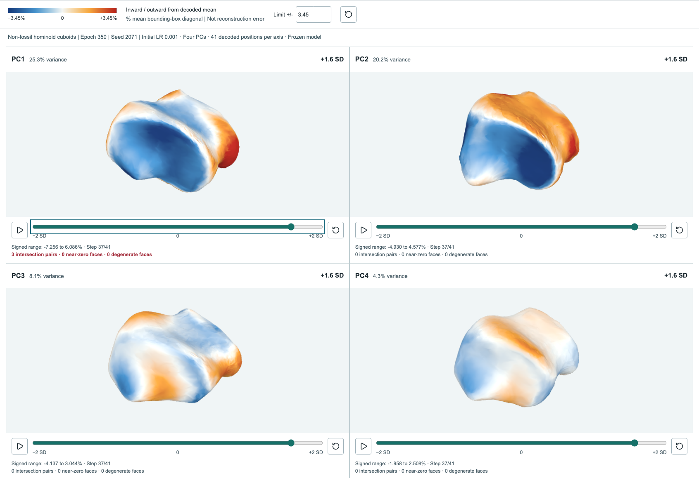
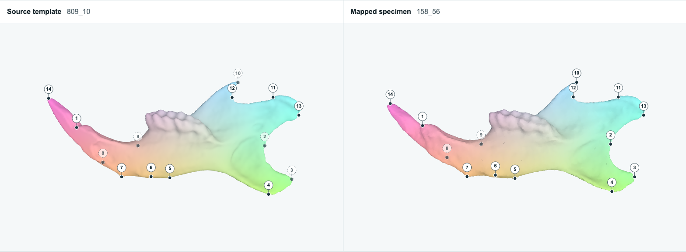

# Dense correspondence and interpretable skeletal morphospaces

**Manuscript in preparation | Preliminary results**

Comparative skeletal biology seeks to relate anatomical variation to function and evolutionary history. The primate cuboid, a bone of the lateral midfoot, presents a demanding case: its joint surfaces, plantar tuberosity and peroneus longus tendon groove form a complex anatomy relevant to foot mechanics. [[1]](#ref-bojsen1979) [[2]](#ref-nowak2010) Comparing this anatomy requires measuring differences across curved surfaces, articular margins and local relief, not only at isolated points.

[Explore the results](https://oothomas.github.io/anthropoid-cuboid-signed-traversal-viewer/) | [Source software](#source-software-and-methodological-credit) | [References](#references)

Non-fossil hominoid cuboids, seed 2071, epoch 350. PCA was fitted to 110 training specimens. Each panel independently varies one PC to +1.6 training-score standard deviations, holding the other components at their mean. Blue and orange/red show inward and outward displacement along the decoded mean surface normals, respectively, as a percentage of its bounding-box diagonal. These colors are not reconstruction errors. Click the image to explore the interactive viewer.

## The methodological gap

Three-dimensional scans capture detailed surfaces, but do not establish which locations correspond between specimens. Anatomical landmarks provide expert-defined anchors, yet may undersample variation between them. [[3]](#ref-watanabe2018) Earlier work, including morphVQ, brought learned descriptors and functional maps into biological morphometrics. [[4]](#ref-thomas2023) This study connects anatomically constrained dense matching to a reconstruction-capable morphospace, so that statistical variation can be examined as changes in surface anatomy.

## A two-stage approach

Stage 1 builds dense correspondences across a sparse network of specimens and templates. Panine et al.'s method uses corresponding anatomical landmarks to construct spectral bases adapted to those anchors. It matches surface functions in these bases and iteratively refines dense point-to-point correspondences, accommodating differences in shape and proportions. [[5]](#ref-ovsjanikov2012) [[6]](#ref-panine2022) Correspondence is a methodological component in its own right because matching errors propagate into shape analysis.

Revised correspondence between mouse mandibles: template 809_10 (left) and its vertices mapped to specimen 158_56 (right), retaining the template triangles. The 14 numbered landmarks mark corresponding anatomical anchors; dashed markers are viewed through the surface. Colors are transferred from the template and indicate location, not error. The right surface is the nearest-vertex target used by Stage 2, not a neural reconstruction. This example uses the revised adaptive-triangulation maps.

Stage 2 uses functional-map networks and a limit-shape common basis to make surface features comparable across specimens. [[7]](#ref-huang2014) [[8]](#ref-huang2019) The autoencoder builds on DISCO-AE, with DiffusionNet surface layers and an SNK-inspired prism decoder adapted for reconstruction from a common latent code. [[9]](#ref-hahner2024) [[10]](#ref-sharp2022) [[11]](#ref-attaiki2023) Principal-component analysis (PCA) summarizes variation in those codes. Decoding along the axes reveals associated anatomical changes, linking statistical relationships among specimens to surface geometry.

## Study scope and initial results

Anthropoid cuboids are the primary application. A non-fossil hominoid subset examines the same element within a narrower taxonomic range; mouse mandibles and humeri test the approach on different skeletal geometries. The current models produce reconstructed surfaces and decoded shape variation for all four datasets. These outputs make local contours, projections and depressions available for anatomical inspection alongside specimen relationships in the morphospace.

Earlier development analyses found agreement between learned shape relationships and manual-landmark and automated pseudolandmark morphometrics, with decoded cuboid axes localizing articular and plantar variation. These findings concern earlier model versions. Reconstruction, morphometric agreement, repeatability, phylogenetic signal and size associations are being reassessed for the revised datasets and models shown here.

## Biological significance

The contribution is a connection between whole-surface measurement and anatomical explanation, complementing established geometric morphometrics. Instead of stopping at separation in a scatterplot, researchers can examine where and how surfaces differ and formulate explicit hypotheses about joint form, tendon pathways and skeletal diversity. Such hypotheses still require comparative or biomechanical tests: decoded variation alone does not establish locomotor adaptation or evolutionary causation.

## Source software and methodological credit

These upstream projects underpin the methods and implementation. Our biological adaptations, quality controls and results are the responsibility of this study.

- [Panine landmark-adapted matching](https://github.com/mpanine/DirichletSteklovLandmarkMatching): Stage 1 non-isometric functional matching with anatomical landmark constraints. [[6]](#ref-panine2022)
- [Surface Maps via Adaptive Triangulations](https://github.com/patr-schm/surface-maps-via-adaptive-triangulations): Foundation for the revised mandible correspondence branch, with project-specific initialization, anchor, solver and export safeguards. [[12]](#ref-schmidt2023)
- [DISCO-AE](https://github.com/Fraunhofer-SCAI/DISCO-AE): Common-basis autoencoding framework underlying Stage 2. [[9]](#ref-hahner2024)
- [DiffusionNet](https://github.com/nmwsharp/diffusion-net): Surface-network layers used in the encoder and decoder. [[10]](#ref-sharp2022)
- [SNK](https://github.com/pvnieo/SNK): Prism-decoder design adapted within our common-basis autoencoder, not an application of SNK's pairwise zero-shot matching procedure. [[11]](#ref-attaiki2023)
- [Robin Magnet's pyFM](https://github.com/RobinMagnet/pyFM): Mesh, spectral and functional-map-network utilities used by the pipeline. Cited directly as software, following the author's attribution guidance. [[13]](#ref-magnetpyfm)

## References

1. Bojsen-Møller F. [Calcaneocuboid joint and stability of the longitudinal arch of the foot at high and low gear push off](https://pmc.ncbi.nlm.nih.gov/articles/PMC1233091/). J Anat. 1979;129(Pt 1):165-176.
2. Nowak MG, Carlson KJ, Patel BA. [Apparent density of the primate calcaneo-cuboid joint and its association with locomotor mode, foot posture, and the midtarsal break](https://doi.org/10.1002/ajpa.21210). Am J Phys Anthropol. 2010;142(2):180-193.
3. Watanabe A. [How many landmarks are enough to characterize shape and size variation?](https://doi.org/10.1371/journal.pone.0198341) PLoS One. 2018;13(6):e0198341.
4. Thomas OO, Shen H, Raaum RL, Harcourt-Smith WEH, Polk JD, Hasegawa-Johnson M. [Automated morphological phenotyping using learned shape descriptors and functional maps: A novel approach to geometric morphometrics](https://doi.org/10.1371/journal.pcbi.1009061). PLoS Comput Biol. 2023;19(1):e1009061.
5. Ovsjanikov M, Ben-Chen M, Solomon J, Butscher A, Guibas L. [Functional maps: a flexible representation of maps between shapes](https://doi.org/10.1145/2185520.2185526). ACM Trans Graph. 2012;31(4):30:1-30:11.
6. Panine M, Kirgo M, Ovsjanikov M. [Non-isometric shape matching via functional maps on landmark-adapted bases](https://doi.org/10.1111/cgf.14579). Comput Graph Forum. 2022;41(6):394-417.
7. Huang Q, Wang F, Guibas L. [Functional map networks for analyzing and exploring large shape collections](https://doi.org/10.1145/2601097.2601111). ACM Trans Graph. 2014;33(4):36:1-36:11.
8. Huang R, Achlioptas P, Guibas L, Ovsjanikov M. [Limit Shapes: A Tool for Understanding Shape Differences and Variability in 3D Model Collections](https://doi.org/10.1111/cgf.13799). Comput Graph Forum. 2019;38(5):187-202.
9. Hahner S, Attaiki S, Garcke J, Ovsjanikov M. [Unsupervised representation learning for diverse deformable shape collections](https://doi.org/10.1109/3DV62453.2024.00158). 2024 International Conference on 3D Vision (3DV). 2024. p. 1594-1604.
10. Sharp N, Attaiki S, Crane K, Ovsjanikov M. [DiffusionNet: discretization agnostic learning on surfaces](https://doi.org/10.1145/3507905). ACM Trans Graph. 2022;41(3):1-16.
11. Attaiki S, Ovsjanikov M. [Shape Non-rigid Kinematics (SNK): A Zero-Shot Method for Non-Rigid Shape Matching via Unsupervised Functional Map Regularized Reconstruction](https://proceedings.neurips.cc/paper_files/paper/2023/hash/dd9b76f050a86a3ded6135ad3556e786-Abstract-Conference.html). Adv Neural Inf Process Syst. 2023;36.
12. Schmidt P, Pieper D, Kobbelt L. [Surface Maps via Adaptive Triangulations](https://doi.org/10.1111/cgf.14747). Comput Graph Forum. 2023;42(2):103-117.
13. Magnet R. [pyFM: Python implementation of Functional Maps](https://github.com/RobinMagnet/pyFM). GitHub [software]. Cited 2026 Oct 14.

## Models in this release

| Dataset | Epoch | Common dimension | Training PCA | Projected tuning | Initial learning rate |
| --- | ---: | ---: | ---: | ---: | ---: |
| [Anthropoid cuboids](https://oothomas.github.io/anthropoid-cuboid-signed-traversal-viewer/cuboid/viewer/) | 250 | 44 | 244 | 52 | 0.001 |
| [Non-fossil hominoid cuboids](https://oothomas.github.io/anthropoid-cuboid-signed-traversal-viewer/hominoids/viewer/) | 350 | 40 | 110 | 26 | 0.001 |
| [Mouse mandibles](https://oothomas.github.io/anthropoid-cuboid-signed-traversal-viewer/mandible/viewer/) | 350 | 44 | 93 | 0 | 0.001 |
| [Mouse humeri](https://oothomas.github.io/anthropoid-cuboid-signed-traversal-viewer/humeri/viewer/) | 350 | 44 | 77 | 0 | 0.0003 |

All four displays use seed 2071, not a selected best seed. Counts are specimens represented in the PCA plots, not total dataset sizes. The hominoid dataset is a subset of the anthropoid collection, not independent evidence.

PCA is fitted to training codes, with tuning specimens projected where available. Confirmation specimens and reference templates are excluded. The mouse models use all non-template specimens for descriptive training, not held-out generalization tests. Shared correspondence construction also limits claims of fully unseen-specimen performance.

## Reading the decoded surfaces

Each panel varies one PC over 41 actual decoder outputs from -2 to +2 training-score standard deviations, holding other components at the training-code mean. Axes are specific to each model and are not aligned across datasets or seeds.

Blue denotes inward and orange/red outward displacement along the decoded mean surface normals, as a percentage of the mean bounding-box diagonal; white is zero. This is not reconstruction error, closest-surface distance or unmapped coverage. Tangential movement is not encoded. Dataset captions and geometry tables report local surface-quality flags; decoded anatomy remains subject to review.

## Genus annotations

Point colors identify genus from the reconciled project sampling labels; the same genus has the same color in both cuboid datasets. Circles are training specimens and triangles are projected tuning specimens. Counts in the genus legend include both partitions. Historical project taxonomic names are retained; this is not a taxonomic revision. KB3133 has no assigned genus and remains Unassigned.

Display annotations are joined by exact specimen identifier. No scores are moved, PCA is not refitted, and no confirmation observations are added. The source hash and minimal public assignments are in `content/taxonomy.json`.

Public project copy is a review-grade draft. The manuscript is in preparation; no publication, peer-review outcome or completed biological validation is implied.
